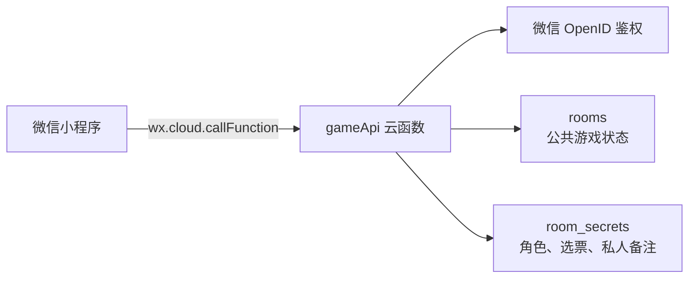

# 阿瓦隆线下助手

[](https://github.com/dfklkc/avalon-offline-helper/actions/workflows/ci.yml)
[](LICENSE)

一个面向线下聚会的原生微信小程序：每位玩家用自己的微信加入同一房间，由微信云开发完成秘密发牌、组队表决、任务投票、刺杀结算与复盘，无需自建常驻服务器。

> 当前版本是可部署的 MVP。它是非官方同人辅助工具，不包含原版游戏图片、字体或其他美术资产。

## 项目状态

当前代码已通过本地静态检查和 11 项领域/云函数状态机测试，但尚未在本仓库维护者的真实 AppID、CloudBase 环境和多台真机上完成最终验收。自动化测试不能替代真实 OpenID、数据库权限和多人并发测试。

## 功能

- 5–10 人建房、6 位房间码加入、准备、离线重连与再来一局。
- 云函数使用安全随机数洗牌，每位玩家只能读取自己的角色和规则允许的视野。
- 完整流程：确认身份、领队组队、全员表决、秘密任务票、三胜/三败、连续五次否决和刺客刺杀。
- 每位玩家可为其他玩家保存四档私密标记和最多 80 字文字备注。
- 每轮组队票结算后公开到个人；任务票始终只公开成功/失败总数。
- 内置规则速览、5–10 人任务人数表，以及本人角色的目标、视野和实战提示。
- 房间页前台每 5 秒同步一次，进入后台立即停止轮询。

典型的一局只需五步：房主建房并分享房间码 → 玩家加入并准备 → 每人私下确认身份 → 按页面提示组队和投票 → 结算后查看身份与逐轮票型。

## 隐私与反作弊

- 客户端不直接读写云数据库，所有请求统一进入 `gameApi` 云函数。
- 云函数只信任 `cloud.getWXContext().OPENID`，不信任客户端传入的玩家、阵营或房主身份。
- `rooms` 和 `room_secrets` 都必须设置为“仅管理端可读写”。
- 角色、未结算选票和私人备注保存在机密文档中，接口只返回当前玩家有权看到的字段。
- 组队票收齐前不返回具体选择；任务票在结算后也不保存到公共历史中的个人名下。
- 身份页面只有按住时显示内容，松手、离开页面或进入后台会立即遮罩；本地只持久化最近房间码。
- “私人备注仅你可见”是指其他玩家无法通过小程序读取；部署该项目的 CloudBase 环境管理员在技术上仍可访问数据库。

详细信任边界见 [架构说明](docs/architecture.md)，收集字段、保存期限和删除方式见 [隐私与数据说明](PRIVACY.md)。

## 规则范围

| 人数 | 善良 | 邪恶 | 五轮任务队人数 | 第 4 轮失败阈值 |
|---:|---:|---:|---|---:|
| 5 | 3 | 2 | 2 / 3 / 2 / 3 / 3 | 1 |
| 6 | 4 | 2 | 2 / 3 / 4 / 3 / 4 | 1 |
| 7 | 4 | 3 | 2 / 3 / 3 / 4 / 4 | 2 |
| 8 | 5 | 3 | 3 / 4 / 4 / 5 / 5 | 2 |
| 9 | 6 | 3 | 3 / 4 / 4 / 5 / 5 | 2 |
| 10 | 6 | 4 | 3 / 4 / 4 / 5 / 5 | 2 |

当前提供两套牌组：

- `classic`：梅林、派西维尔、刺客及按人数配置的莫甘娜、莫德雷德或奥伯伦。
- `beginner`：梅林、忠臣、刺客和普通爪牙，减少首局信息量。

湖中仙女、兰斯洛特和自定义角色板暂未纳入 MVP。

## 技术架构



- 前端：原生微信小程序 JavaScript、WXML、WXSS。
- 后端：微信云开发 CloudBase 云函数与文档型数据库。
- 云端依赖：`wx-server-sdk@4.0.2`。
- 本地测试：Node.js 18 或更高版本，无需安装根目录第三方依赖。

## 快速部署

### 1. 准备账号与工具

```bash
git clone https://github.com/dfklkc/avalon-offline-helper.git
cd avalon-offline-helper
```

用微信开发者工具导入仓库根目录。准备一个真实微信小程序 AppID、与其关联的 CloudBase 环境，以及有该环境权限的开发者账号。默认的 `touristappid` 只能预览界面，无法完成真实 OpenID 和多人云端测试。

### 2. 配置 AppID 和云环境

将 `project.config.json` 中的 AppID 替换为真实值：

```json
{
  "appid": "wx你的真实AppID"
}
```

在 `miniprogram/config/index.js` 中填写云环境 ID：

```js
module.exports = Object.freeze({
  CLOUD_ENV: 'cloud1-你的环境ID',
  GAME_API_FUNCTION: 'gameApi',
  POLL_INTERVAL_MS: 5000,
  POLL_MAX_DELAY_MS: 30000,
  STORAGE_KEYS: Object.freeze({
    ROOM_CODE: 'avalon:lastRoomCode'
  })
})
```

不要把 AppSecret、SecretId、SecretKey 或其他密钥提交到仓库。

### 3. 创建数据库集合

在云开发控制台创建：

```text
rooms
room_secrets
```

两个集合都必须设为**仅管理端可读写**。客户端直接执行 `wx.cloud.database().collection(...).get()` 被拒绝是预期行为。

### 4. 部署云函数

在微信开发者工具中右键 `cloudfunctions/gameApi`，选择：

```text
上传并部署：云端安装依赖
```

函数名必须保持为 `gameApi`，且应部署到小程序初始化时所选的同一个环境。不要为它增加 HTTP 触发器。

### 5. 本地检查与多人验收

```bash
npm run check
npm test
```

随后至少使用 5 个不同微信账号验证建房、发牌、投票、备注隔离、断线恢复和完整结算。详细操作见：

- [完整部署指南](docs/deployment.md)
- [多人真机测试清单](docs/manual-test.md)

## 项目结构

```text
miniprogram/              小程序页面、组件样式和云函数服务层
cloudfunctions/gameApi/   云函数入口与阿瓦隆领域规则
tests/                    无第三方依赖的规则与状态机测试
scripts/                  小程序静态校验器
docs/architecture.md      架构、隐私边界与升级方向
docs/deployment.md        AppID、CloudBase 与发布步骤
docs/manual-test.md       多账号端到端验收清单
PRIVACY.md                数据字段、管理员边界与删除说明
```

## CloudBase 免费环境说明

以下信息核对日期为 2026-08-23，套餐规则可能随时调整：免费体验环境适合开发和内测，不能视为永久免费的生产服务；小程序正式发布后应及时确认环境到期时间并选择合适套餐。10 人持续游玩 2 小时、每 5 秒同步一次，仅定时同步就约有 14,400 次云函数请求，并伴随数据库读取。发布前请以 [CloudBase 资源点价格文档](https://cloud.tencent.com/document/product/876/127357) 和 [CloudBase 价格文档](https://cloud.tencent.com/document/product/876/75213) 为准。

## 当前限制与路线图

- 当前同步方式是 5 秒轮询，不是实时推送。
- 不支持观战、聊天、房主转让、湖中仙女、兰斯洛特或任意自定义板子。
- 房间尚无自动 TTL；部署者必须制定保留期限并定期成对清理两个集合中的过期房间。
- 后续可增加仅含公开字段的投影集合，再安全地使用数据库实时监听。

## 参与贡献

欢迎提交 Issue 和 Pull Request。提交前请运行 `npm run check` 与 `npm test`，并确保没有把真实密钥、他人 OpenID、角色分配或私人备注加入测试数据。详细约定见 [CONTRIBUTING.md](CONTRIBUTING.md)。

安全问题请按 [SECURITY.md](SECURITY.md) 私下报告，不要在公开 Issue 中附带真实房间数据。

## 开源许可与声明

代码采用 [MIT License](LICENSE) 开源。“阿瓦隆”及相关游戏名称、规则与商标归各自权利人所有；本项目与其权利人没有隶属或授权关系，仅作为非官方线下辅助工具提供。
