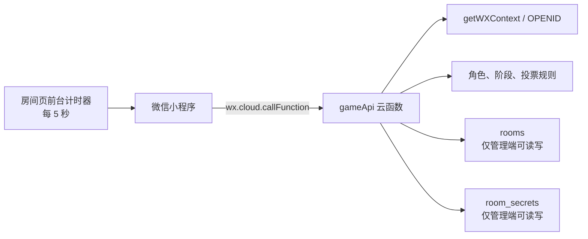

# 架构说明

## 目标和边界

该项目面向“玩家坐在同一张桌边，每人使用自己的微信”的场景。系统负责隐藏信息的发放、房间状态和投票结算，不试图替代玩家的线下发言和讨论。

当前 MVP 优先级是：

1. 角色和未公布选票不能被其他玩家读取。
2. 房间中的所有变更都必须经过服务端的身份和阶段校验。
3. 不自建服务器，使用微信小程序内置的 `wx.cloud` 链路。
4. 同步方案先保持简单和可调试，在真实使用量证明有需要后再引入实时推送。

## 当前请求链路



客户端不使用 `wx.cloud.database()` 读取上述集合。它每 5 秒调用一次 `gameApi` 的房间同步能力，并用服务端返回的单份快照更新界面。创建房间、加入、开局、提名队伍或投票后，客户端可立即再同步一次，不用等待下一个轮询周期。

轮询应只在房间页可见时运行，页面进入后台或销毁时必须停止计时器。正常的界面更新延迟是 0–5 秒；当前实现不应宣称为强实时。

## 信任边界

### OpenID 是服务端身份

`gameApi` 由小程序通过事件型云函数调用。云函数使用：

```js
const { OPENID } = cloud.getWXContext()
```

判断调用者。客户端传入的 `openid`、`playerId`、`isHost` 或类似字段都不能作为授权依据。OpenID 在同一个小程序内可作为玩家标识；UnionID 不保证存在，本 MVP 不依赖它。

获取 OpenID 的云函数不应复用为 Web/HTTP 公开入口。CloudBase 官方文档指出，在混合调用来源和函数实例复用时，运行时环境变量可能残留，从而产生错误身份风险。

### 两个集合均为管理端专用

- `rooms` 保存房间成员、当前阶段、队伍、已公布结果、按轮统计的组队票历史和游戏进度。
- `room_secrets` 保存角色分配、角色视野所需数据、公布前的选票，以及按备注所有者隔离的 `notesByPlayer`。

两者都设为“仅管理端可读写”。原因不只是 `room_secrets` 包含秘密：如果客户端能直接改写 `rooms`，它就可以伪造房主、跳过阶段或重复投票。

云函数以管理端身份访问数据库，客户端安全规则不会代替它做业务授权。因此每个修改类 action 都应检查：

- OpenID 是否已在房间中；
- 是否只有房主或当前队长可操作；
- 当前阶段是否允许该操作；
- 人数、队伍大小和选项是否合法；
- 调用者是否已经投过票；
- 任务失败票是否只由邪恶玩家提交。

`savePlayerNote` 是修改私密数据的 action。它使用云函数从 `getWXContext()` 得到的 OpenID 确定备注所有者，参数中的 `targetPlayerId` 只表示“这条备注描述谁”，不表示“将备注写到谁的账户”。客户端不能通过伪造 `ownerOpenid`、`playerId` 或其他字段覆盖别人的备注。

### 最小化返回数据

同步房间时，服务端只返回当前玩家可见的快照。不应把整份 `room_secrets` 文档返回后再让前端隐藏字段，因为小程序调试器和网络面板仍能看到原始数据。

发牌时只向调用者返回：

- 自己的角色和阵营；
- 该角色按规则应看到的玩家列表；
- 该角色的详细规则文案。

规则速览中的“梅林能看到哪类邪恶角色”、“7 人第 4 轮需要两张失败票”等是静态规则，可以公开展示。它与当前房间的角色分配必须严格分离：速览页不需要、也不得获取 `room_secrets`，本人身份页的响应中也不得包含其他玩家的完整角色。角色视野所必需的玩家列表是唯一例外，且只能严格按阿瓦隆规则返回。

私人备注的读写规则是：

- 房间快照中的 `privateView.playerNotes` 只能是当前调用 OpenID 自己的备注映射；服务端内部的 `notesByPlayer` 不会原样返回；
- 每个目标玩家可保存一个私人标记和一段文字备注；
- `savePlayerNote` 只返回调用者本人更新后的备注，不返回房间内其他所有者的数据；
- 私人标记和文字备注不进入公共房间状态、投票历史或云函数日志。

两种投票的公开策略刻意不同：

- **组队票：**本轮未全部收齐时，只返回已提交人数和自己是否已提交；全部收齐并结算后，才向房间成员公开每个玩家的赞成/反对选择，并将汇总和逐人结果按轮次保留于可见历史中。
- **任务票：**无论是否已结算，都不向客户端返回“某个玩家投了成功或失败”的对应关系；结算后永远只公开成功总数、失败总数和任务成败。

## 为什么当前选择 5 秒轮询

当前设计每个玩家只定期请求一份小型房间快照，优点是：

- `rooms` 无需开放客户端读权限；
- 断网、小程序切后台和重连的行为容易理解；
- 不占用数据库实时推送连接数；
- 对线下回合制投票，5 秒延迟通常可接受。

代价是每个前台客户端持续产生云函数和数据库调用。以 10 人、2 小时、每 5 秒一次为例，仅定时同步就约有 14,400 次请求，还未包括创建、投票等变更调用。应在 CloudBase “套餐用量”中观察真实资源点消耗，不应根据免费体验配额承诺可支持的房间数。

## 升级路线：公共投影 + 单文档 watch

当真实使用数据显示 5 秒延迟或轮询成本无法接受时，可增加专用集合，例如：

```text
room_public_views/{roomCode}
```

该文档只包含可对所有房间成员公开的字段：阶段、座位昵称、队长、当前队伍、已提交数量、已结算的逐人组队票历史，以及任务票的成功/失败总数。`notesByPlayer`、角色和任务票与玩家的对应关系不得进入公共投影。每个客户端只对这一个文档建立一个 `watch`，页面离开时调用 `close()`。

升级时仍须保持：

- `rooms` 和 `room_secrets` 继续仅管理端可读写；
- 公共投影只能由 `gameApi` 写入；
- 客户端对投影只读，并通过安全规则限制为房间成员；
- 角色、原始选票、OpenID 列表不出现在投影文档中；
- 变更操作仍全部调用云函数，`watch` 只用来接收已审查的状态。

截至 2026-08-23，CloudBase 免费体验版和个人版都只提供 10 个实时推送连接，每次 `.watch()` 占用一个，直到关闭。10 人房间每人一个连接已用尽配额，多房间或额外主持设备需要更高套餐或继续轮询。

## 官方参考

以下状态说明截至 2026-08-23：

- [CloudBase 资源点价格与套餐限制](https://cloud.tencent.com/document/product/876/127357)
- [CloudBase 文档型数据库概述](https://cloud.tencent.com/document/product/876/19369)
- [CloudBase 数据库安全规则](https://cloud.tencent.com/document/product/876/41802)
- [CloudBase 云函数实例复用与 getWXContext](https://docs.cloudbase.net/cloud-function/instance)
- [CloudBase 数据库实时推送](https://docs.cloudbase.net/database/realtime)
